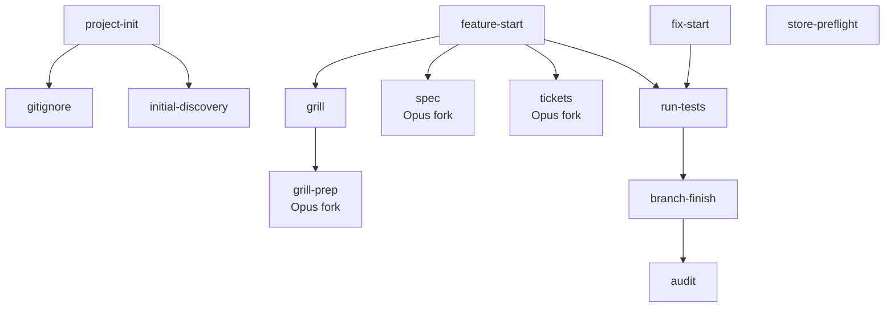

# mayo-flow

Personal Claude Code workflow: skills plus the global `CLAUDE.md` that
references them. Spec-first, branch-per-feature, TDD, Conventional Commits.

## Layout

- `mayo-flow-*/SKILL.md` — one folder per skill.
- `mayo-interactive-understanding-html/` — standalone teaching-page skill (`SKILL.md` + `render.py`), not part of the dev flow.
- `mayo-interactive-diagramer/` — builds the 3-tab diagram block (files, sequence, UML) for the teaching page (`SKILL.md` + `diagramer.py`).
- `explain-diff-html/` — investigates a diff, branch or PR and hands the narrative to the teaching-page skill.
- `CLAUDE.md` — the global instructions (`~/.claude/CLAUDE.md`).

`~/.claude/skills/mayo-flow-*`, `~/.claude/skills/mayo-interactive-understanding-html` and `~/.claude/CLAUDE.md` are symlinks into
this repo, so Claude Code reads what is versioned here.

## Flow



- **Start:** `project-init` once per project, `initial-discovery` before a phase.
- **Feature:** `feature-start` → `grill` (with `grill-prep`) → `spec` → `tickets` → TDD loop.
- **Fix:** `fix-start` → TDD loop.
- **Finish:** `run-tests` gates `branch-finish`, which also checks the diff against the spec, runs the app once, records a one-line retro candidate in its report without asking, and can propose `audit`.
- **UI:** `design` is the single entry point for Impeccable commands; `project-init`, `feature-start`, `tickets`, `branch-finish` and `audit` call it when the work touches UI.
- **Release:** `store-preflight` before uploading an .ipa/.aab.
- **Context:** `handoff` leaves a handoff before `/clear` and resumes from it.

## Tests

From the repo root; the suite is these two commands:

```
python3 -m unittest discover -s tests                  # SKILL.md frontmatter check
python3 -m unittest discover -s mayo-flow-run-tests    # run-tests detector
```

## Evals

Outcome evals for skills live in `evals/` (design: `docs/features/2026_11_18_skill_evals/spec.md`).

```
python3 -m evals.run run feature-start --trials 1 --max-budget-usd 5 --timeout 1200
python3 -m evals.run report feature-start
```

- Each trial runs headless `claude -p` in a throwaway git copy of the suite's fixture and checks the artifacts it leaves.
- Results are appended to `evals/results/<skill>.jsonl` and committed. Raw traces go to `evals/traces/` and are gitignored.
- Real runs call the model and cost tokens (the budget cap is per trial).
- Only `--skill-ref working-tree` works for now; comparing versions means checking out the old version (see "Later" in the spec).

## History

Changes are Conventional Commits, scoped by skill (e.g.
`feat(grill): ...`). Milestones are tagged. To see how one skill evolved:

```
git log -p -- mayo-flow-grill/
```

## Not included

`archify*` and `synced/` live in
`~/.claude/skills/` but are managed elsewhere.
