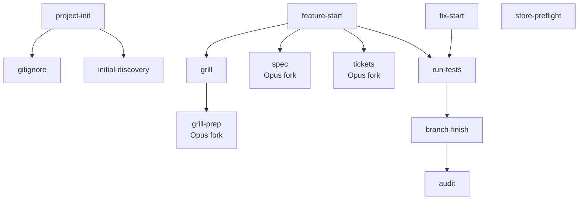

# mayo-flow

Personal Claude Code workflow: skills plus the global `CLAUDE.md` that
references them. Spec-first, branch-per-feature, TDD, Conventional Commits.

## Layout

- `mayo-flow-*/SKILL.md` — one folder per skill.
- `mayo-interactive-understanding-html/` — standalone teaching-page skill (`SKILL.md` + `render.py`), not part of the dev flow.
- `mayo-interactive-diagramer/` — builds the 3-tab diagram block (files, sequence, UML) for the teaching page (`SKILL.md` + `diagramer.py`).
- `explain-diff-html/` — investigates a diff, branch or PR and hands the narrative to the teaching-page skill.
- `CLAUDE.md` — the global instructions (`~/.claude/CLAUDE.md`).

`~/.claude/skills/mayo-flow-*`, `~/.claude/skills/mayo-interactive-understanding-html` and `~/.claude/CLAUDE.md` are symlinks into
this repo, so Claude Code reads what is versioned here.

## Install

Clone the repo, then link the skills (from the repo root):

```
mkdir -p ~/.claude/skills
for d in mayo-flow-*; do ln -s "$PWD/$d" ~/.claude/skills/"$d"; done
```

The skills work on their own: call any of them by hand with
`/mayo-flow-<name>`. What decides *when* Claude uses them is `CLAUDE.md`
(section 9 says to start `feature-start` for a feature, `branch-finish` when
done). Pick one:

- **Full flow.** Use `CLAUDE.md` as your global instructions. With no existing
  `~/.claude/CLAUDE.md`: `ln -s "$PWD/CLAUDE.md" ~/.claude/CLAUDE.md`. With one,
  do not overwrite it: merge the sections you want. Claude then follows the
  process on its own (branch first, spec first, TDD, Conventional Commits).
- **Optional.** Skip `CLAUDE.md`. Nothing starts by itself; run the skills you
  want by hand. Your own rules stay untouched.

`mayo-flow-design` needs the `impeccable` plugin when the work touches UI.
`grill-prep`, `spec` and `tickets` run as Opus subagents, which costs more
than the main model.

## Flow



- **Start:** `project-init` once per project, `initial-discovery` before a phase.
- **Feature:** `feature-start` → `grill` (with `grill-prep`) → `spec` → `tickets` → TDD loop.
- **Fix:** `fix-start` → TDD loop.
- **Finish:** `run-tests` gates `branch-finish`, which also checks the diff against the spec, runs the app once, records a one-line retro candidate in its report without asking, and can propose `audit`.
- **UI:** `design` is the single entry point for Impeccable commands; `project-init`, `feature-start`, `tickets`, `branch-finish` and `audit` call it when the work touches UI.
- **Release:** `store-preflight` before uploading an .ipa/.aab.
- **Context:** `handoff` leaves a handoff before `/clear` and resumes from it.

## Tests

From the repo root; the suite is these two commands:

```
python3 -m unittest discover -s tests                  # SKILL.md frontmatter check
python3 -m unittest discover -s mayo-flow-run-tests    # run-tests detector
```

## Evals

Outcome evals for skills live in `evals/` (design: `docs/features/2026_11_18_skill_evals/spec.md`).

```
python3 -m evals.run run feature-start --trials 1 --max-budget-usd 5 --timeout 1200
python3 -m evals.run report feature-start
python3 -m evals.run run gitignore --baseline --judge        # same task without the skill, judged
python3 -m evals.run judge gitignore --judge-model haiku     # judge stored snapshots not yet judged
python3 -m evals.run run handoff-resume --condition casual   # two-phase: skill | casual | floor
python3 -m evals.run run feature-start-e2e --trials 3 --max-budget-usd 6 --timeout 2400            # full flow, then code
python3 -m evals.run run feature-start-e2e --baseline --trials 3 --max-budget-usd 6 --timeout 2400 # direct request
python3 -m evals.run decisions feature-start-e2e             # label open decisions explicit | silent (opus)
```

Suites: `feature-start`, `run-tests`, `gitignore`, `handoff` (WRITE mode only), `handoff-resume` (two phases: write, then resume in a fresh session), `project-init`, `fix-start`, `branch-finish`, `tickets`, `feature-start-e2e` (see below).

- Each trial runs headless `claude -p` in a throwaway git copy of the suite's fixture and checks the artifacts it leaves.
- A suite is `evals/cases/<suite>/suite.json`; its `skill` field names the skill directory under test (e.g. `mayo-flow-feature-start`). Optional `checks` (names from `evals/checks.py`; default: the feature-start set) and `fixture` can be set on the suite or overridden per case. A fixture may ship a `setup.sh` (not copied; run in the copy after the initial commit) to pre-build branches, as `unittest-feature-done` does for `branch-finish`. A suite may list `allow_writes` (paths relative to the fixture, e.g. `.claude/handoff.md`): protected paths that `-p` would otherwise deny to Write/Edit; a PermissionRequest hook approves exactly those, and every other denial is still recorded. Every `claude -p` call (trials and judge) runs with `CLAUDE_CODE_DISABLE_AUTO_MEMORY=1`, so nothing carries over between phases, trials or conditions through `~/.claude/projects/*/memory/`.
- Results are appended to `evals/results/<suite>.jsonl` and committed. Raw traces go to `evals/traces/` and are gitignored. When a call hits the account's usage limit (429 `usage_limit_reached`), `run`, `judge` and `decisions` write no row for it, print the reset time and exit non-zero; rows already written stay, so rerun after the reset.
- Real runs call the model and cost tokens (the budget cap, `--max-budget-usd`, defaults to 5 USD and is per trial).
- Quota: on a Pro plan these runs eat the usage limit (Opus sub-skills are most of a run's cost). Use `--trials 1` by default and `--trials 2` only to compare two versions of a skill; if the two trials disagree, rerun just that case with more. The cheap skills (`run-tests`, `gitignore`, `handoff`) have suites; leave Opus-heavy ones (`feature-start`, `tickets`, `audit`, `initial-discovery`) for later, one trial each.
- Only `--skill-ref working-tree` works for now; comparing versions means checking out the old version (see "Later" in the spec).
- Every trial saves a snapshot beside its trace (`<trace>.snapshot.json`: text files new or changed vs the fixture's base commit, size-capped, plus branch, commits, task prompt and final reply), so it can be judged later without re-running the skill. Like traces, snapshots are local (gitignored); trials recorded before snapshots existed cannot be judged.
- `--baseline` runs the same case without the skill: the leading `/<skill>` is stripped from the prompt, `--disable-slash-commands` is passed, and `evals/block_skills_hook.py` (a PreToolUse hook) denies any read of `.claude/skills`. Rows carry `"isolation": "skills-blocked"`; `report` leaves out plain-condition rows without it. Records carry `condition` (`skill` | `baseline`; absent on old lines = skill). Process checks legitimately fail in baseline; the comparison is the judge score.
- `--judge` (on `run`) and `judge <suite>` score snapshots with an LLM judge against `evals/cases/<suite>/rubric.json` (3-4 outcome-based, skill-agnostic criteria, 1-5 each with a one-line reason). The judge is `claude -p` with no tools and `--safe-mode`, sees only the task prompt and the snapshot (never the condition), and defaults to `--judge-model haiku`. Each judgement is a separate JSONL line `{"kind": "judge", "trace_path": <the trial's>, "judge", "judge_model", "rubric_hash", ...}`; `judge <suite>` skips trials already judged under the current rubric.
- `report` adds, per case, the mean judge score for skill vs baseline with n, and prints "not enough trials" until each condition has n >= 2.
- `python3 -m evals.run [--evals-dir DIR] recheck <suite>` recomputes only the `TRACE_CHECKS` (checks that need just the trace) from the local traces, rewrites rows whose outcome changed in place with a `rechecked` date, and makes no model call.
- The `remote` case of `branch-finish` uses a local bare origin built by the fixture, whose update hook is `evals/remote_update_hook.sh` (refuses and logs deletions and non-fast-forward pushes).
- Every trial records `tokens` (input, output, cache read, cache write, total; summed over every model the run used; null on old lines). `report` shows, per case and condition, mean tokens, cost and turns, with skill's delta (absolute and %) against baseline (or casual), under the same "not enough trials" rule.
- Two-phase cases (`handoff-resume`): a case with `prepare` runs phase 1 (`prepare`: the earlier session, which plants facts and asks to get ready for `/clear`) and then phase 2 (`prompt`: a new `claude -p` with no history, told to pick up) in the same throwaway copy. `--condition skill` sends both prompts as written; `casual` sends both without the leading `/<skill>` and with `--disable-slash-commands`; `floor` skips phase 1, so phase 2 starts cold. `--baseline` is refused on two-phase cases without a `direct` prompt, and `casual`/`floor` on one-phase ones. The record keeps `phase1` and `phase2` (trace, cost, turns, time, tokens, error; `phase1` is null for floor) and sums both into the top-level numbers; if phase 1 fails, phase 2 is not run. The judge sees both prompts without the skill. The report adds a phase 2 (resume) cost table and each check's passed/trials per condition, and compares skill with casual (floor is the lower bound).
- Fact checks: a case may list `facts`, `{"id", "kind", ...}` checked against the trial's starting commit: `unchanged` (`paths` are as they were), `matches` (some file of `glob` contains regex `pattern`), `kept_history` (the starting commit is still in HEAD's history) and `no_question` (the final reply does not end on a question). Each lands in `checks` under its id.
- Quota for baseline and judge: both are opt-in. A baseline trial costs about as much as a skill trial; the judge adds one cheap call per trial. To see whether a skill helps, run `--trials 2` with and without `--baseline` on one cheap suite first. Calibrate the judge against your own scores on 2-3 real outputs before trusting it.
- `feature-start-e2e` asks whether the `mayo-flow-feature-start` chain pays off against a direct request, end to end. Two cases: `exclude-filter` (plain, on `list-cli`) and `persist-tags` (trap, on `list-cli-trap`: two entries share a name and `data.json` has a version header, neither mentioned in the feature text). The case stores `feature` and `headless` once; `prepare`, `prompt` and `direct` are templates over `{feature}` and `{headless}` (plain replace, expanded by `run.py`). `skill` runs phase 1 (`/mayo-flow-feature-start`, stop after the spec) and phase 2 (a fresh session implements from the spec, skills on, no merge). `--baseline` skips phase 1 and sends the expanded `direct` (the feature text plus the headless line, nothing about process) with slash commands off and skills blocked; on a two-phase case it is only allowed when the case has `direct`. The owner's `~/.claude/CLAUDE.md` stays loaded in both. The judge's task prompt is the expanded `direct` in both conditions.
- Scoring: fact kind `hidden_tests` (`dir` relative to the suite folder, `hidden/<case>/test_*.py`, stdlib `unittest`, driving the CLI through `subprocess`) discovers the test ids, runs them in one subprocess (`evals/hidden_runner.py`, 300 s timeout) and records one check `hidden:<Class>.<method>` each; a test missing from the output counts as failed. `unittest_green` runs the fixture's own suite. `passed` is: result success, visible suite green, every hidden test passes. Each row carries `hidden_hash`, since `suite_hash` covers only `suite.json`. `tests/test_evals_suites.py` checks each case: hidden tests fail on the bare fixture, pass with `hidden/<case>/reference.patch`, and (trap case) `naive.patch` passes the visible tests but fails a hidden one per trap.
- `observe` lists fact entries like `facts`, but their results go to the row's `observed` (never into `checks` or `passed`): `grill_written`, `baseline_wrote_spec`, `branch_is_feature`, `work_committed`, `questions` (grill items for skill; reply lines ending in `?` plus `AskUserQuestion` uses for baseline), `skill_calls` (`Skill` tool uses; a baseline row above 0 is invalid) and `hidden_seen` (the trace mentions the hidden folder; a row with true is invalid). Observations see both phases. Neither invalid-row rule is enforced by code: check them in the report.
- `decisions` per case lists `{id, text, tests}` (dictated by the code: right when all named hidden tests pass) and `{id, text, open: true}`. `run.py decisions <suite>` (default `--judge-model opus`) asks the judge, per open decision of each stored snapshot, whether the work states its choice (`explicit`) or just picks one (`silent`); it appends `kind: "decisions"` lines and skips trials already labelled under the current decisions. The judge is not blind (`grill.md`/`spec.md` betray the skill condition), and a choice stated only in a commit body is missed.
- `report` for this suite adds an end-to-end table per case and condition (hidden tests passed/run over tests, not trials; mean cost, tokens, wall time, phase 1's share of cost and time, questions, denials, boolean observation counts) and a decisions table (dictated: trials where its tests passed; open: trials labelled explicit). Cost is the comparable number: `tokens` mixes Sonnet with the Opus sub-skills. Trial numbers are global per suite hash, case and condition, so a second `run` continues after the highest stored trial.
- Quota: one skill trial costs about $2-4 and a baseline trial $0.3-0.8; `--max-budget-usd` applies per `claude` call, so per phase. Use `--max-budget-usd 6 --timeout 2400`; the defaults (5 USD, 900 s) cut a phase 2 short. n=3 per case and condition is about $20-30.

## History

Changes are Conventional Commits, scoped by skill (e.g.
`feat(grill): ...`). Milestones are tagged. To see how one skill evolved:

```
git log -p -- mayo-flow-grill/
```

## Not included

`archify*` and `synced/` live in
`~/.claude/skills/` but are managed elsewhere.
