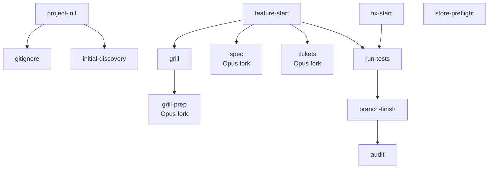

# mayo-flow

Personal Claude Code workflow: skills plus the global `CLAUDE.md` that
references them. Spec-first, branch-per-feature, TDD, Conventional Commits.

## Layout

- `mayo-flow-*/SKILL.md` — one folder per skill.
- `mayo-interactive-understanding-html/` — standalone teaching-page skill (`SKILL.md` + `render.py`), not part of the dev flow.
- `CLAUDE.md` — the global instructions (`~/.claude/CLAUDE.md`).

`~/.claude/skills/mayo-flow-*`, `~/.claude/skills/mayo-interactive-understanding-html` and `~/.claude/CLAUDE.md` are symlinks into
this repo, so Claude Code reads what is versioned here.

## Flow



- **Start:** `project-init` once per project, `initial-discovery` before a phase.
- **Feature:** `feature-start` → `grill` (with `grill-prep`) → `spec` → `tickets` → TDD loop.
- **Fix:** `fix-start` → TDD loop.
- **Finish:** `run-tests` gates `branch-finish`, which also checks the diff against the spec, runs the app once, asks a one-line retro, and can propose `audit`.
- **Release:** `store-preflight` before uploading an .ipa/.aab.
- **Context:** `handoff` leaves a handoff before `/clear` and resumes from it.

## History

Changes are Conventional Commits, scoped by skill (e.g.
`feat(grill): ...`). Milestones are tagged. To see how one skill evolved:

```
git log -p -- mayo-flow-grill/
```

## Not included

`archify*`, `mayo-interactive-understanding-html` and `synced/` live in
`~/.claude/skills/` but are managed elsewhere.
