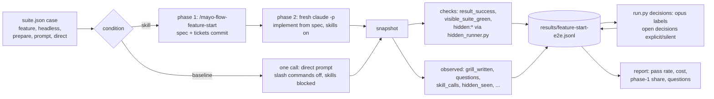

# Feature-start overhead eval

## Goal

Test the owner's feeling that the `mayo-flow-feature-start` chain (grill,
design, spec, tickets) is too much: that asking the agent directly would give
the same result. A new end-to-end suite runs the same feature under two
conditions, (A) the full flow then implementation from the spec and (B) a
direct request, and scores both with hidden acceptance tests. It compares
pass rate, decisions made explicitly or silently, cost, wall time and the
questions put to the owner. One plain case and one case with a codebase trap
show when the flow pays off.

Source: the "feature-start, overhead" entry of the Skill backlog in
`docs/features/2026_11_18_skill_evals/spec.md`. Every decision below comes
from `grill.md` in this folder; the implementation-level choices the grill
left open are marked "(spec)".

Out of scope: changing `mayo-flow-feature-start` itself (skip the grill for
small features, auto-accept, fold `design.md` into the spec). That comes after
the results, on its own branch.

## Decisions

### 1. A new suite, `evals/cases/feature-start-e2e/`

- **Chosen:** a separate suite with its own `suite.json`, results file,
  checks, prompts, rubric and `hidden/` folder.
- **Why:** the existing `feature-start` suite scores spec quality and stops
  before code. Adding code cases there would change its `suite_hash` and break
  `report` and the rubric for both kinds of case.
- **Alternatives:**

  | option | pros | cons | |
  |---|---|---|---|
  | New suite | old results stay comparable; own rubric | one more suite to maintain | chosen |
  | Extra cases in `feature-start` | one place | new suite hash, rubric mismatch, spec-only checks break | rejected |

- **Where it fails:** nothing shared, so no blast radius on old results.

### 2. Skill condition: two phases in one working copy

- **Chosen:** phase 1 is `/mayo-flow-feature-start <feature>`, stopping after
  the spec (and tickets) commit. Phase 2 is a fresh `claude -p` in the same
  copy that implements from the spec. This reuses the `prepare`/`prompt`
  machinery of `handoff-resume`.
- **Why:** the overhead is exactly the phase-1 cost and time. A fresh phase 2
  also tests whether the spec alone carries the decisions.
- **Alternatives:**

  | option | pros | cons | |
  |---|---|---|---|
  | Two phases, fresh phase 2 | overhead measured exactly; existing machinery | not how the owner works (one session) | chosen |
  | One session, spec then code | closer to real use | overhead not separable; new runner path | later condition |

- **Where it fails:** a real session keeps the grill conversation in context;
  this design throws it away, so phase 2 may do slightly worse than reality.
  State it in the results.

### 3. Baseline: its own `direct` prompt built from the same feature text

- **Chosen:** the case stores the feature text once (`feature`) and the
  headless line once (`headless`). `prepare` and `direct` are templates that
  use `{feature}` and `{headless}`; `run.py` expands them. `direct` is the
  feature text plus the headless line ("never ask, pick sensible defaults,
  commit your work"), nothing about process. The judge's task prompt is the
  expanded `direct` for both conditions (spec).
- **Why:** the baseline must be what the owner would type. A hand-written
  second copy of the feature text drifts. The "Discarded first comparison" in
  the skill-evals spec shows how a bad baseline prompt fakes a gap (+3.5).
- **Alternatives:**

  | option | pros | cons | |
  |---|---|---|---|
  | Templates with `{feature}`/`{headless}` | one source of truth; difference is only the process | small expansion code | chosen |
  | Strip `/<skill>` from the skill prompt | no new key | keeps "stop after the spec, do not implement": the baseline would build nothing | rejected |
  | Two literal prompts | no code | drift between the two texts | rejected |

- **Where it fails:** a literal `{` in the feature text would break
  `str.format`. Use plain `str.replace` on the two names only.

### 4. The owner's global `~/.claude/CLAUDE.md` stays loaded in both

- **Chosen:** no change to settings sources. Baseline rows record
  descriptive observations `baseline_wrote_spec` and `branch_is_feature`.
- **Why:** "ask directly with my CLAUDE.md loaded" is the comparison the owner
  actually faces.
- **Alternatives:**

  | option | pros | cons | |
  |---|---|---|---|
  | Keep CLAUDE.md in both | real-world comparison | baseline may imitate the process by hand | chosen |
  | Strip CLAUDE.md in both | cleaner ablation | not the owner's setup; may also unload `~/.claude/skills` (unverified) | later condition |

- **Where it fails:** if the baseline writes a spec and a branch by hand, the
  two conditions converge and the eval measures the skill files, not "process
  vs none". The observations make that visible.
- **Open concern:** the CLAUDE.md says "invoke `mayo-flow-feature-start`".
  The baseline runs with `--disable-slash-commands` and
  `block_skills_hook.py`, but `Skill` is in `ALLOWED_TOOLS`. It is not yet
  verified that the Skill tool cannot load a skill in that mode. An
  observation `skill_calls` (count of `Skill` tool uses) is recorded on every
  row; a baseline row with `skill_calls > 0` is invalid.

### 5. Harness: baseline on a two-phase case

- **Chosen:** `check_condition` allows `baseline` on a case that has
  `prepare` only if it also has `direct`. Baseline then skips phase 1 (like
  `floor`) and runs the expanded `direct` as-is, plain (slash commands off,
  skills blocked). `strip_skill` returns the prompt unchanged when it does not
  start with `/<skill>` instead of raising.
- **Why:** smallest change that fits the existing conditions.
- **Alternatives:** a generic `conditions` map in the suite (condition ->
  prompts and flags). More flexible, but speculative with only one user.
- **Where it fails:** a typo in a prompt's slash command is no longer an
  error in `strip_skill`. `AllSuitesTest` still checks that every first-run
  prompt (`prepare` if present, else `prompt`) starts with `/<skill>`, which
  catches it.

### 6. Plain case: `exclude-filter` on `list-cli`

- **Chosen:** `--exclude-tag`, repeatable, combinable with `--tag`, on the
  existing `list-cli` fixture.
- **Why:** no trap; its open decisions are already enumerated in
  `list-cli-spec`; its feature-start cost was measured once ($1.03).
- **Where it fails:** small enough that the skill may legitimately skip the
  grill; decision 8 handles that.

### 7. Trap case: `persist-tags` on a new fixture `list-cli-trap`

- **Chosen:** feature "persist tag edits": `listcli tag NAME --add T` /
  `--remove T`, saving to the `--file` JSON. Two traps, both visible only in
  the code and data, never in the feature text:
  - (a) two entries share the name `milk` (dairy milk and oat milk). A
    name-keyed dict merges them, or an edit hits both.
  - (b) `data.json` is `{"version": 2, "entries": [...]}` and `load_entries`
    unwraps it. A naive `json.dump(entries)` drops the header.
- **Why:** mirrors the closedclaw findings (a name-keyed `Map` merging two
  "Software" areas; `reorder` dropping areas). Writing to disk gives real
  data-loss risk. The two invariants are independent.
- **Alternatives:**

  | option | pros | cons | |
  |---|---|---|---|
  | New fixture with two traps | traps grounded in a real session; deterministic | hand-made, so it may not bite (decision 13 guards that) | chosen |
  | Reuse `big-app` | larger, more realistic | its traps are about migrations and handoff, not this feature | rejected |

- **Where it fails:** a model that reads `data.json` before coding sees both
  traps at once. That is the point: the question is whether the flow makes it
  look.

### 8. Phase 1 does not force the grill

- **Chosen:** the phase-1 prompt does not say "Do NOT skip the grill". The
  skill decides. Every row records the observation `grill_written`.
- **Why:** the question is about the flow as it behaves. Forcing the grill
  inflates overhead.
- **Where it fails:** if the skill skips the grill on both cases, the eval
  says nothing about the grill itself, only about the spec. Results are split
  by `grill_written` so that shows.

### 9. `report` picks columns by the conditions present

- **Chosen:** `_conditions` looks at the conditions in the rows, not at
  `phase2`: rows with `casual` or `floor` give skill/casual/floor; otherwise
  skill/baseline. A new end-to-end table shows, per case and condition:
  hidden-test pass rate (tests passed / tests run, not trials), mean cost
  (headline), tokens, wall time, phase-1 share of cost and of time, mean
  questions, mean denials, and counts of each boolean observation.
- **Why:** `tokens` mixes Sonnet with the Opus subagents (grill-prep, spec,
  tickets), so only `cost_usd` compares across conditions.
- **Where it fails:** `handoff-resume` rows have `phase2` and casual/floor,
  so they keep today's columns. A suite with only skill rows shows skill vs an
  empty baseline column, as today.

### 10. Hidden acceptance tests as a fact kind

- **Chosen:** fact kind `hidden_tests` with a `dir` relative to the suite
  folder (`hidden/<case>`). After the trial, the parent discovers the test ids
  in-process (hidden tests import only the stdlib), then runs them in one
  subprocess, `evals/hidden_runner.py <dir>`, with `cwd=repo`,
  `PYTHONPATH=repo` and a timeout (300 s). The runner prints JSON
  `{test id: true|false}`. Each test becomes a check `hidden:<Class>.<method>`.
  A test missing from the output (timeout, crash) counts as failed. A second
  kind, `unittest_green`, runs the fixture's own suite
  (`python -m unittest discover -s tests`, same env and timeout) as
  `visible_suite_green`. The record gets `hidden_hash` (the existing
  `record.skill_hash` over the case's hidden dir), because `suite_hash` covers
  only `suite.json`.
- **Why:** the agent's code runs only in a subprocess with a timeout, so a
  hanging or crashing implementation cannot take down the runner.
  Discovering ids in the parent gives a fixed denominator even on timeout.
- **(spec) `fact_checks` change:** a fact kind may return a dict of checks
  instead of one bool; `fact_checks` merges it.
- **Alternatives:**

  | option | pros | cons | |
  |---|---|---|---|
  | Discover in parent, run in one subprocess | fixed denominator; agent code isolated | one extra small script | chosen |
  | Run everything in-process | no script | imports agent code into the runner; a hang blocks the eval | rejected |
  | One subprocess per test | per-test timeout | slower; more code | rejected |

- **Where it fails:** a hidden test that imports `listcli` would load agent
  code in the parent during discovery. A suite test forbids `listcli` imports
  in `hidden/`; tests drive the CLI through `subprocess` only.

### 11. "Decisions right or silent"

- **Chosen:** each case lists `decisions`: `{id, text, tests}` for decisions
  the code dictates (right = all named hidden tests pass, computed by
  `report`), and `{id, text, open: true}` for genuinely open ones. A new
  command `run.py decisions <suite>` (default `--judge-model opus`) asks the
  judge, per open decision, whether the work states its choice (`explicit`)
  or just picks one (`silent`), from the snapshot and the reply. It appends
  `{"kind": "decisions", "trace_path", "decisions": {id: {"label",
  "reason"}}, "judge_model", "decisions_hash", "cost_usd", "error"}` lines.
  It reuses `judge._call` and `judge._json_object`.
- **Why:** the spec file and the reply are where an explicit choice shows up;
  only a reader can tell "chose and said so" from "happened to do X".
- **Alternatives:**

  | option | pros | cons | |
  |---|---|---|---|
  | Separate `decisions` judge, labels | answers the actual question | new command and line kind | chosen |
  | Encode as rubric criteria (1-5) | reuses `judge` as is | scores, not labels; criteria count capped at 4 | rejected |
  | Regex over spec/reply | no model cost | cannot tell explicit from accidental | rejected |

- **Where it fails:** the judge is not blind: `grill.md` and `spec.md` betray
  the skill condition (accepted, already in the backlog as "Judge
  blindness"). State it in the results and spot-check a few labels with the
  owner. The snapshot keeps commit subjects, not bodies, so a choice stated
  only in a commit body is missed. Accepted; noted in the results.

### 12. Hidden tests assert invariants only

- **Chosen:** tests check what any correct implementation must do, through
  the CLI surface the feature text pins. The feature text pins command and
  flag names, `--file`, exit code 0 on success, and the `list` output format
  already in the fixture. It pins nothing the open decisions are about.
- **Why:** otherwise the tests measure agreement with the case author, not
  correctness.
- **Where it fails:** an invariant like "the file is unchanged" also holds
  when the command does not exist at all. So every trap test first makes a
  successful edit on a unique name; otherwise it would pass on the
  unmodified fixture and break decision 13. An implementation that refuses
  all edits then fails every test, which is right.

### 13. Fixture validation in `tests/test_evals_suites.py`

- **Chosen:** per case: the visible tests pass on the fixture; every hidden
  test fails on the unmodified fixture; every hidden test passes with
  `hidden/<case>/reference.patch` applied (`git apply` in a prepared copy).
  For the trap case, `hidden/<case>/naive.patch` passes the visible tests and
  fails at least one hidden test of each trap. The checks run through the same
  `hidden_tests` fact kind the trials use.
- **Why:** without the naive patch the trap may not bite and the case says
  nothing.
- **Where it fails:** the patches are hand-maintained; a fixture edit breaks
  them, which the test then reports. That is the intent.

### 14. "Questions put to the owner" is descriptive

- **Chosen:** observation `questions`. Skill: the number of top-level numbered
  items (`^\d+\. `) in `docs/10_features/*/grill.md`, i.e. what would have
  reached the owner interactively; 0 when there is no grill. Baseline: the
  final reply's lines ending in `?` plus `AskUserQuestion` tool uses in the
  trace (not in `ALLOWED_TOOLS`, so usually 0).
- **Where it fails:** grill.md format is the grill skill's, not fixed; a
  format change miscounts. Approximate by design, never pass/fail.

### 15. Phase 2 runs with skills on

- **Chosen:** phase 2 is the real flow (tickets, TDD loop, delegate,
  run-tests). Its prompt: implement the feature in the feature folder under
  `docs/10_features/` from its spec and tickets, commit, do not merge. It
  stops before `branch-finish`. Hidden tests run on the final working tree,
  whatever the branch. Recommended run flags: `--max-budget-usd 6` (per
  claude call, so per phase) and `--timeout 2400`.
- **Cost estimate:** $2-4 per skill trial, $0.3-0.8 per baseline trial, about
  $20-30 for 2 cases x 2 conditions x n=3.
- **Where it fails:** a phase-2 timeout leaves partial work. The hidden tests
  still run on it (today's runner already runs checks after a timeout) and the
  record carries the error, so `report` shows it as errored, not as a clean
  fail.

### 16. Pre-registered reading rule

- **Chosen:** written into the skill-evals spec before any run, in a new
  "Feature-start overhead results" section:
  - B matches A if B's hidden-test pass rate is within one test of A's on both
    cases and A costs more.
  - A pays off only if it wins the trap case by at least one hidden invariant
    in at least 2 of 3 trials.
- **Why:** prevents reading the rule into the numbers afterwards.

### 17. (spec) Observations live outside `passed`

- **Chosen:** a case key `observe` lists fact entries like `facts`. Their
  results go to `record["observed"]` (bools and ints), not to `checks`, so
  `passed` stays "result success, visible suite green and every hidden test
  passes". New fact kinds for observations: `check` (`{"name": <CHECKS
  name>}`, e.g. `tree_clean` as `work_committed`, `branch_is_feature`),
  `questions`, `tool_uses` (count of a named tool, e.g. `Skill`,
  `AskUserQuestion`) and `trace_mentions` (true if any tool input mentions
  one of the given strings). `matches` is reused for `grill_written` and
  `baseline_wrote_spec`. Observations see the events of both phases.
- **Why:** descriptive facts (branch, committed, grill written) must not turn
  a correct implementation into a "fail".
- **Alternatives:** putting them in `checks` and ignoring them in `report`.
  Rejected: `passed` would lie in the JSONL.
- **Where it fails:** old rows have no `observed`; `report` treats it as
  empty.

### 18. (spec) Hidden-test secrecy: keep the path out of sight, detect leaks

- **Chosen:** the hidden folder is never named in any prompt, and the agent
  works in a temp copy with no link to this repo. Every row records the
  observation `hidden_seen` (`trace_mentions` of `feature-start-e2e` and
  `/hidden/`). A row with `hidden_seen: true` is invalid.
- **Why:** a blocking hook would need to run in the skill condition too,
  where today no hook runs; detection is enough when nothing points at the
  path.
- **Alternatives:**

  | option | pros | cons | |
  |---|---|---|---|
  | Keep path unseen + detect in trace | no new hook; cheap | does not prevent a leak, only flags it | chosen |
  | PreToolUse hook like `block_skills_hook.py` in all conditions | prevents the read | new hook wiring for skill runs; changes skill-condition behaviour | rejected |

- **Where it fails:** a path built at runtime (`$HOME/...`) slips past the
  string match, as with `block_skills_hook.py`. Low risk: the agent has no
  reason to look there.

### 19. (spec) Snapshot before checks

- **Chosen:** `run_trial` takes the snapshot before running checks and facts.
- **Why:** the visible suite and the agent's own tests run code that may
  write files; the snapshot must show what the agent left, not what the tests
  left. Read-only checks of other suites are unaffected by the order.

### 20. (spec) Trial numbers are global

- **Chosen:** `run` numbers new trials after the highest stored trial for the
  same suite hash, case and condition.
- **Why:** the grill allowed "number globally or document it". Duplicate
  numbers across batches already confused the branch-finish results; the fix
  is a few lines.
- **Where it fails:** two `run` processes on the same suite at once would
  pick the same numbers. Not handled; runs are sequential in practice.

### Guards carried from the grill

- **Prompt leakage:** the feature texts do not mention the trap, duplicate
  names, the file header, unknown tags or empty results. The v1 hint "also
  decide how unknown tags and an empty result are reported" is dropped. A
  suite test asserts a word list is absent from `feature`.
- **Permission-denial noise:** denials are recorded per row and shown per
  condition; a failure driven by a denial is noted as harness noise in the
  results.
- **Wall time** includes subagent waits; parallel delegate agents can make
  the skill faster but costlier. Report both.

### Not measurable here (state in the results)

- `design.md`: the CLI fixture has no UI, so `mayo-flow-design` is skipped;
  the design overhead the owner felt is not measured.
- What the owner adds in a grill: headless runs auto-accept every
  recommendation. The eval measures grill-prep's research, not the owner's
  answers. This matches the observed "yes to all" session.

## Architecture



Case shape (trap case, abridged):

```json
{
  "id": "persist-tags",
  "fixture": "list-cli-trap",
  "feature": "Persist tag edits: add a `tag` command, `listcli tag NAME --add TAG` / `--remove TAG`, ...",
  "headless": "This is a headless run: never ask the user anything; pick sensible defaults yourself and commit your work.",
  "prepare": "/mayo-flow-feature-start {feature}\n\n{headless} Stop right after committing the spec (and the tickets, if the skill produces them). Do not implement any code.",
  "prompt": "Implement the feature in the feature folder under docs/10_features/ from its spec.md and tickets. {headless} Do not merge.",
  "direct": "{feature}\n\n{headless}",
  "checks": ["result_success"],
  "facts": [
    {"id": "visible_suite_green", "kind": "unittest_green"},
    {"id": "hidden", "kind": "hidden_tests", "dir": "hidden/persist-tags"}
  ],
  "observe": [
    {"id": "grill_written", "kind": "matches", "glob": "docs/10_features/*/grill.md", "pattern": "."},
    {"id": "baseline_wrote_spec", "kind": "matches", "glob": "docs/**/spec.md", "pattern": "."},
    {"id": "branch_is_feature", "kind": "check", "name": "branch_is_feature"},
    {"id": "work_committed", "kind": "check", "name": "tree_clean"},
    {"id": "questions", "kind": "questions"},
    {"id": "skill_calls", "kind": "tool_uses", "tool": "Skill"},
    {"id": "hidden_seen", "kind": "trace_mentions", "strings": ["feature-start-e2e", "/hidden/"]}
  ],
  "decisions": [
    {"id": "duplicate_name", "text": "What an edit does when two entries share the name", "tests": ["..."]},
    {"id": "file_header", "text": "Keeping the file's version header on save", "tests": ["..."]},
    {"id": "unknown_name", "text": "What happens for a name no entry has", "open": true}
  ]
}
```

## Implementation plan

Each step: write the failing test first, see it fail for the right reason,
implement, green, full suite (`python3 -m unittest discover -s tests`), one
commit.

1. **Prompt templates and baseline on two-phase cases.** `strip_skill`
   tolerates a prompt without `/<skill>`. `run.py` expands `{feature}` and
   `{headless}` in `prepare`, `prompt` and `direct` (plain `str.replace`).
   `check_condition` allows `baseline` on a two-phase case that has `direct`;
   the trial skips phase 1 and sends the expanded `direct` plain. The judge
   task is the expanded `direct` when present. Tests in
   `tests/test_evals_run.py` with the fake claude.
2. **Snapshot before checks.** Move the snapshot ahead of `run_checks` and
   `fact_checks` in `run_trial`. Test: a fact that writes a file into the
   repo; the file is not in the snapshot.
3. **Hidden tests and visible suite as fact kinds.** `evals/hidden_runner.py`
   (prints `{id: bool}` JSON), `hidden_tests` and `unittest_green` kinds,
   `fact_checks` merges dict results, `fact["dir"]` resolved against the
   suite folder in `run_trial`, `hidden_hash` on the record. Tests in
   `tests/test_evals_checks.py` on a hand-built repo with a tiny hidden dir:
   a passing test, a failing one, a hanging one (timeout -> all missing ids
   false).
4. **Observations.** `observe` key -> `record["observed"]`, outside
   `passed`; kinds `check`, `questions`, `tool_uses`, `trace_mentions`;
   observations see both phases' events. Tests in `test_evals_checks.py`
   (kinds) and `test_evals_run.py` (record shape, `passed` ignores them).
5. **Global trial numbering.** Test in `test_evals_run.py`: a second `run`
   with existing rows starts after the highest stored trial.
6. **Report by conditions present + end-to-end table.** Tests in
   `tests/test_evals_report.py`: skill+baseline rows with `phase2` give
   skill/baseline columns; handoff-style rows keep skill/casual/floor; the
   table shows hidden pass rate as tests passed/run, cost, wall time, phase-1
   share, questions, observation counts; dictated decisions shown as right
   when their tests pass.
7. **Decisions judge.** `run.py decisions <suite>` with prompt builder,
   parser (labels must be `explicit` or `silent` for every open id) and
   unjudged filter; `report` shows explicit/open per case and condition.
   Tests in `tests/test_evals_judge.py` and `test_evals_run.py` with the fake
   claude.
8. **Plain case.** `evals/cases/feature-start-e2e/suite.json` with
   `exclude-filter` on `list-cli`, `hidden/exclude-filter/test_*.py`,
   `reference.patch`, a 3-criterion outcome rubric (`AllSuitesTest` requires
   one). Suite tests: validation of decision 13, no `listcli` import in
   hidden tests, no leak words in `feature`, `direct` has no skill words.
   Update `AllSuitesTest`: the first-run prompt (`prepare` if present, else
   `prompt`) starts with `/<skill>`.
9. **Trap case.** Fixture `evals/fixtures/list-cli-trap/` (wrapped
   `data.json` with two `milk` entries, `load_entries` unwrapping, visible
   `list` tests), case `persist-tags`, hidden tests, `reference.patch`,
   `naive.patch`. Suite tests as in step 8 plus the naive-patch check.
10. **Docs.** README Evals section (suite, `direct`, `observe`,
    `decisions`, recommended flags). Skill-evals spec: Layout, Result record
    (`observed`, `hidden_hash`), and the new "Feature-start overhead
    results" section holding the pre-registered reading rule (decision 16),
    committed before any real run.
11. **Real runs** (manual, not TDD). One smoke trial per case and condition
    first; check `skill_calls` is 0 on baseline and `hidden_seen` is false
    everywhere. Then n=3 per cell, `decisions` judge, owner spot-check of a
    few labels, results written into the section from step 10.

## Test seams

- **`evals.run.main([...])` with the fake claude** (`EVALS_CLAUDE_BIN`): the
  public CLI. Covers conditions, templates, phases, record shape, trial
  numbering and the `decisions` command without model calls. Existing seam.
- **`evals.checks.fact_checks(repo, base, trace, facts)`**: the one entry
  point for facts and observations. Hand-built repos and hidden dirs exercise
  every new kind, including the runner subprocess.
- **`evals.report.render_report(records)`**: pure function over rows; tables
  are asserted as text.
- **`evals.judge`** decisions prompt/parse functions: pure, plus one fake
  claude call through `main`.
- **`tests/test_evals_suites.py`**: the suite and fixtures as data. Validates
  the cases through `fact_checks`, the same path a trial uses.

## Test cases

`tests/test_evals_run.py`
- `strip_skill` returns a prompt without `/<skill>` unchanged.
- `{feature}` and `{headless}` are expanded in `prepare`, `prompt`, `direct`;
  a literal `{x}` elsewhere is left alone.
- `--baseline` on a two-phase case with `direct`: one claude call, prompt is
  the expanded `direct`, `--disable-slash-commands` and the skills hook are
  passed, `phase1` is null, `isolation` is set.
- `--baseline` on a two-phase case without `direct` is refused.
- The judge snapshot's prompt is the expanded `direct` in both conditions.
- A file written by a fact during checks is not in the snapshot.
- `observed` is on the record; a false observation does not make `passed`
  false.
- `hidden_hash` is on the record when the case has `hidden_tests`.
- A second `run` numbers trials after the stored maximum for the same suite
  hash, case and condition.
- `decisions <suite>` appends one `kind: "decisions"` line per unlabelled
  trial and skips labelled ones.

`tests/test_evals_checks.py`
- `hidden_tests`: one check per test method, named `hidden:<Class>.<method>`,
  true/false as the tests ran.
- `hidden_tests` with a hanging test: every id the runner did not report is
  false, and the call returns within the timeout.
- `hidden_tests` runs with `cwd=repo` and the repo on `PYTHONPATH`.
- `unittest_green`: true on a green repo, false on a red one.
- `check` kind wraps a named check.
- `questions`: counts numbered items in `grill.md`; with no grill, counts
  `?`-ended reply lines plus `AskUserQuestion` uses.
- `tool_uses` counts `Skill` uses across both phases' events.
- `trace_mentions` is true when a tool input mentions a listed string.

`tests/test_evals_report.py`
- Rows with `phase2` and only skill/baseline conditions get skill/baseline
  columns.
- Handoff-resume-style rows keep skill/casual/floor.
- The end-to-end table shows hidden pass rate as tests passed/run per case
  and condition, cost, wall time, phase-1 share of cost and time, mean
  questions and denials, and observation counts.
- A dictated decision is shown right only when all its tests passed.
- Open decisions show explicit/open counts from `decisions` lines; trials
  without labels are counted as unlabelled.
- Rows without `observed` render without error.

`tests/test_evals_judge.py`
- The decisions prompt lists only the open decisions and never the
  condition.
- The parser rejects a missing id or a label other than `explicit`/`silent`.

`tests/test_evals_suites.py` (`FeatureStartE2eSuiteTest`)
- Each case's visible suite passes on its fixture.
- Each hidden test fails on the unmodified fixture.
- Each hidden test passes with `reference.patch` applied.
- `persist-tags`: `naive.patch` passes the visible tests and fails at least
  one duplicate-name test and at least one header test.
- No hidden test imports `listcli`.
- `feature` contains none of: version, header, duplicate, same name, unknown,
  empty.
- `direct` contains no skill words (`AllSuitesTest.SKILL_WORDS`).
- `AllSuitesTest`: the first-run prompt of every case starts with `/<skill>`.

Hidden tests, `exclude-filter` (each on its own temp copy of a known
`data.json`, via `python -m listcli list --file ...`):
- `--exclude-tag dairy` lists rice and salt only.
- `--exclude-tag dairy --exclude-tag spice` lists rice only.
- `--tag pantry --exclude-tag spice` lists rice only.

Hidden tests, `persist-tags` (temp copy of a known wrapped `data.json`, via
`python -m listcli tag/list --file ...`). Every test starts with a
successful edit (exit 0) on a unique name as a precondition. Without it, the
invariant tests would pass on the unmodified fixture, where `tag` does not
exist and the file is never touched (decision 13 needs them to fail there).
- `--add` on a unique name persists: a later `list --tag T` shows it.
- `--remove` on a unique name persists.
- After any edit the entry count is unchanged.
- After any edit the file is still a JSON object with `"version": 2` and
  `list` still loads it.
- After an edit, every other entry is unchanged (same data, same order).
- An edit on the duplicate name `milk` either exits non-zero with the file
  byte-identical, or changes exactly one `milk` entry and leaves the other
  untouched.
