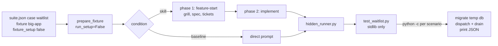

# Medium eval case with traps (grill must run)

**Status:** tickets 01-07 done 2026-11-25 (case, traps, patches, docs, suite
tests; merged into `main`). Open, so this spec is not archived: ticket 08, the
real runs (smoke trial, then n=3 per condition, then the two small cases
rerun), which need the owner's explicit OK on cost.

## Goal

Add a third case, `waitlist`, to the `feature-start-e2e` suite. It is a
medium feature on the `big-app` fixture, large enough that
`mayo-flow-feature-start` runs the grill instead of calling the feature
small. That finally measures the full chain (grill, spec, tickets, then
implementation) against a direct request. In the 2026-11-24 runs the grill
never ran (`grill_written` 0/3 in every skill cell), so the chain was untested.

Source: `grill.md` in this folder (all 14 decisions accepted as recommended).
Context: `docs/features/2026_11_24_feature_start_overhead_eval/` and the
"Feature-start overhead results" section of
`docs/features/2026_11_18_skill_evals/spec.md`. Implementation-level choices
the grill left open are marked "(spec)".

Out of scope: changing `mayo-flow-feature-start` (for example, forcing the
grill or a size threshold), a UI case, a `--case` filter, the "tickets
threshold" backlog experiment.

## Decisions

### 1. Fixture: reuse `big-app`, without its `setup.sh`

- **Chosen:** the case uses `"fixture": "big-app"`, on a plain `main` with one
  commit.
- **Why:** real size (core, worker, API, numbered migrations, a structure doc
  with conventions) is the only thing that reliably moves the model off
  "small". Its traps come from documented conventions already in the code,
  not from hand-made data.
- **Alternatives:**

  | option | pros | cons | |
  |---|---|---|---|
  | Reuse `big-app` | real size; traps already grounded | needs a way to skip `setup.sh` (decision 6) | chosen |
  | Copy `big-app` to a new fixture | no harness change | ~900 duplicated lines that drift | rejected |
  | Grow `list-cli-trap` | small change | the skill still calls it small | rejected |
  | New hand-made fixture | full control | most work; traps hand-made | rejected |

- **Where it fails:** `handoff-resume` also uses `big-app`. Any later fixture
  edit for one suite can break the other; both suites' tests then report it.

### 2. Feature: plot waitlist, from scratch

- **Chosen:** a member joins and leaves a waitlist for a taken plot and
  season. Cancelling a booking books the plot for the first member in line,
  and that member is told through the outbox.
- **Why:** it touches every layer (migration, core, worker, API) and has real
  forks: inline vs worker job, joining a free plot, a member who already holds
  a booking.
- **Alternatives:** booking transfer (may still be judged small); refunds
  (money rules the fixture's docs do not ground). Both rejected.
- **Where it fails:** `handoff-resume` builds this same feature halfway. The
  from-scratch agent must not see that work; decision 6 guarantees it.

### 3. Placement: a third case in `feature-start-e2e`

- **Chosen:** add `waitlist` to the existing `suite.json`.
- **Why:** reuses the rubric, the suite-test class, `report` and `decisions`.
  The suite hash changes for all cases, so the two small cases are rerun
  (about $2.50 at n=3).
- **Alternatives:**

  | option | pros | cons | |
  |---|---|---|---|
  | Third case, rerun all | no new code paths | small cases cost a rerun | chosen |
  | `--case` filter on `run` | run only the new case | new flag for one use (YAGNI) | rejected |
  | New suite folder | old hash stays | duplicated rubric and suite-test class | rejected |

- **Where it fails:** see the open concern under decision 4: the rerun is
  not a pure replication of 2026-11-24.

### 4. Phase-1 prompt: "answer yourself" clause

- **Chosen:** `prepare`, in all three cases, gains a sentence like: "When the
  skill would ask you a question, take its recommended answer yourself and
  continue." It does not mention the grill. `direct` is unchanged.
- **Why:** headless, a grill may stop at "Round 1" waiting for the owner;
  phase 1 then ends with no spec and the trial is wasted. Not naming the grill
  keeps decision 8 of the overhead spec (measure the flow as it behaves).
- **Alternatives:** keep the text (risk of a stalled grill); force the grill
  ("Do NOT skip the grill", v1's mistake). Both rejected.
- **Where it fails:** the model may still stop and ask; `spec_written`
  (decision 12) shows it.
- **Open concern:** the clause changes the skill-condition prompt of the two
  small cases too. Their rerun is a replication of the 2026-11-24 results only
  in part: a skipped-grill difference could come from the clause, not chance.
  State this in the results.

### 5. No `design.md`

- **Chosen:** no design step is expected. `big-app` has no UI, so
  `mayo-flow-design` says "no UI".
- **Why:** whether the impeccable plugin even loads under `-p` is unverified;
  a UI case is a separate backlog item.
- **Where it fails:** the design overhead the owner felt stays unmeasured.
  State it in the results.

### 6. Skip `setup.sh` with a case key `"fixture_setup": false`

- **Chosen:** `prepare_fixture(source, dest, run_setup=True)`. `run_trial`
  and the suite test's `facts()` pass `run_setup=case.get("fixture_setup",
  True)`.
- **Why:** smallest change; `setup.sh` is already never copied
  (`ignore_patterns`), so skipping it leaves no waitlist text in the copy.
- **Alternatives:** move `setup.sh` into a handoff-only fixture (churns the
  `handoff-resume` suite and its hash); copy the fixture (decision 1). Both
  rejected.
- **Where it fails:** a fixture whose `main` itself depends on `setup.sh`
  would be broken by the key. `big-app`'s `main` does not; the red/green test
  pins that for `big-app`.

### 7. Feature text pins only the tested surface

- **Chosen:** the feature text names: `POST /waitlist` with `plot_id`,
  `member_id`, `season`, returning 201 and an `id`; `DELETE /waitlist/<id>`
  leaves the line; `DELETE /bookings/<id>` books the plot for the first member
  in line (first come, first served); the new booking shows in
  `GET /members/<id>/bookings`; the member is told by an outbox message with
  template `waitlist_promoted`. It says nothing about price, concession,
  email, migrations, worker/job/inline, transactions, "twice"/"again" or ties.
- **Why:** the hidden tests need a fixed surface; everything else must come
  from reading the code.
- **Where it fails:** "outbox" hints at the worker convention. Accepted: it
  is the fixture's only message channel.
- **Open concern (spec):** the hidden tests can only see messages in the
  outbox list passed to `worker.runner.drain`. Handlers get no outbox, so the
  message must go out through a worker job. That partly dictates the open
  `inline_or_job` decision: "inline" can only mean the booking is made inline
  and the message is a job. An agent that invents its own outbox module fails
  `notify`. Accepted as the fixture's convention (`docs/structure.md`), but
  the judge's reading of `inline_or_job` should be about the booking, not the
  message.

### 8. Four traps, each a real invariant

Rule for each: could a careful engineer choose otherwise and say so? If yes,
it is an open decision, not a trap.

- **T1 price.** The promoted booking's `price_cents` equals what that member
  pays when booking the same plot directly. Compared against a direct API
  booking in a separate scenario, never a hard-coded formula. The promoted
  member has a concession and the original booker does not, so the trap
  bites. Naive failure: copying the cancelled booking's price.
- **T2 frozen migrations.** A database has the original 0001-0004 applied and
  recorded; then the repo's `db.migrate` runs; the waitlist must work. Naive
  failure: editing an existing migration (it is recorded by name and never
  rerun). The hidden dir keeps copies of the original SQL; a suite test
  asserts they equal the fixture's.
- **T3 never promoted twice.** When the promoted member's new booking is
  cancelled, the next member in line gets the plot and the first is not
  rebooked. Naive failure: the promoted entry is never marked or removed.
- **T4 member without email.** After cancel and `drain`: exactly one active
  booking for the plot and season, no outbox message with `to` None, no job
  `dead`. Loose on purpose: "booked without a message" and "skipped to the
  next member" both pass. The line holds a member with email after the one
  without, so the skip path has someone to promote.
- **Excluded:** transaction rollback (no deterministic way to make promotion
  fail from outside); same-second ties (SQLite returns insertion order, so it
  would not bite; hidden tests freeze distinct times per join).
- **Validation:** `naive.patch` fails at least one test per trap and passes
  the visible suite; `reference.patch` passes everything.
- **Where it fails:** the hidden tests avoid every open decision (joins only
  on taken plots, members holding no other booking that season, each member
  joins once). An implementation that refuses a legitimate join in those
  scenarios fails, which is right.

### 9. Hidden tests run each scenario in a subprocess

- **Chosen:** each test runs `python -c <script>` with `cwd` = the repo. The
  script migrates a temp sqlite file, freezes the clock, calls
  `allotment.api.routes.dispatch` and `allotment.worker.runner.drain`, and
  prints JSON (statuses, bookings, outbox, job counts). The test file itself
  imports only the stdlib.
- **Why:** keeps decision 10 of the overhead spec: agent code never loads in
  the runner's parent during discovery. A hang hits the runner timeout.
- **Alternatives:** imports inside test methods (lazy). Works, but would
  force loosening the "no fixture import in `hidden/`" rule. Rejected.
- **Where it fails:** the scenario scripts live as strings in the test file,
  so a syntax slip only shows when the test runs. The fixture validation
  (decision 8) catches it, because every test must pass with the reference
  patch.

### 10. Smoke gate if the skill still skips the grill

- **Chosen:** run one skill trial first. If `grill_written` is false, stop,
  enlarge or reword the feature, and smoke again. Never force the grill and
  never select trials. Then n=3, every trial reported, split by
  `grill_written`. Pre-registered: fewer than 2 of 3 trials with a grill means
  the case missed its design goal, and no full-chain verdict is read from it.
- **Alternatives:** run up to 5 trials until 3 have a grill (selection bias);
  a forced-grill variant (v1 again). Both rejected.
- **Where it fails:** rewording after a smoke changes the suite hash; the
  smoke row is then in an older hash and not mixed into the n=3 cell.

### 11. Decisions for the `decisions` judge

- **Dictated** (each tied to hidden tests): `fifo_promotion`, `notify` (one
  `waitlist_promoted` message to the promoted member's email),
  `price_for_member` (T1), `frozen_migrations` (T2), `promoted_once` (T3),
  `member_without_email` (T4), `leave` (a left entry is not promoted).
- **Open** (judged explicit vs silent only, at most 4): `inline_or_job`,
  `join_free_plot`, `already_holding`, `join_twice`.
- **Where it fails:** the judge is still not blind (`grill.md` betrays the
  skill condition). State it again in the results.

### 12. Suite-test and observation changes

- (a) `test_cases` lists three ids and `waitlist`'s fixture.
- (b) `LEAKS` becomes per case: the shared words plus a case list. For
  `waitlist`: `price, concession, email, migrat, worker, job, inline,
  transaction, twice, again`.
- (c) The import rule names each case's fixture package (`listcli`,
  `allotment`) and checks only that case's hidden dir.
- (d) `facts()` honours `fixture_setup`.
- (e) `baseline_wrote_spec` glob becomes `docs/10_features/[0-9]*/spec.md`
  in all three cases. Today's `docs/**/spec.md` matches `big-app`'s archived
  pricing spec and would be true on every row.
- (f) New observations in all three cases: `spec_written` (`matches`,
  `docs/10_features/[0-9]*/spec.md`) and `tickets_written` (`matches`,
  `docs/10_features/*/tickets/*.md`).
- (g) The naive-patch check covers all four traps of `waitlist`.
- **Open concern (spec):** observations run on the final tree, after phase
  2. `spec_written` is meant as "a spec existed after phase 1", but a phase 2
  that writes the missing spec itself also makes it true. Accepted for now;
  when a row has `spec_written` true, read the phase-1 trace to confirm. A
  per-phase observation would be new machinery and is not built (YAGNI until
  this happens).

### 13. Pre-registered reading rule (written before any run)

- Per case, same shape as before: the baseline matches the skill on
  `waitlist` if its hidden-test pass rate is within one test and the skill
  costs more. The skill pays off if it wins at least one trap invariant
  (T1-T4) in at least 2 of 3 trials.
- The full-chain verdict counts only trials with `grill_written` and needs at
  least 2 of 3 (decision 10).
- If the skill wins only through traps that grill-prep named in `grill.md`,
  record it as "the grill's research paid".
- Rejected: a cost-adjusted rule (pass rate per dollar), invented after the
  fact and hard to read.

### 14. Run budget and flags

- `--max-budget-usd 8 --timeout 3600` (per claude call, so per phase).
  Phase 1 has three Opus subagents (grill-prep, spec, tickets); phase 2 may
  delegate tickets.
- Estimate: skill $4-9 per trial, baseline $0.5-1.5; about $15-30 for n=3
  per condition, plus about $2.50 for the two small cases. Run each condition
  as its own batch because of the 5-hour usage limit. Real runs need the
  owner's explicit OK.

### Blind spots carried from the grill (state in the results)

- **Tickets confound:** a medium plan gets tickets, so phase 2 runs the
  ticket and delegate loop. Cost differences mix grill, spec, tickets and
  delegation.
- **Phase 2 depends on phase 1:** read `spec_written` before any hidden-test
  failure in the skill condition.
- **Precondition apart from traps:** one plain `test_join_and_promote` that
  every trap scenario builds on, so a wrong route shape does not read as "all
  traps failed".
- **Visible suite:** `big-app`'s own tests must stay green; agent tests that
  use wall-clock time could flake. One smoke check.
- **Owner spot-check** of `decisions` labels is still open from 2026-11-24
  and now covers three cases.

## Architecture



Hidden dir layout:

```
evals/cases/feature-start-e2e/hidden/waitlist/
  test_waitlist.py      scenarios as subprocess scripts
  migrations_0001_0004/ copies of the original SQL (T2)
  reference.patch
  naive.patch
```

## Implementation plan

Each step: write the failing test first, see it fail for the right reason,
implement, green, full suite (`python3 -m unittest discover -s tests`), one
commit.

1. **`run_setup` on `prepare_fixture`.** Test in `tests/test_evals_run.py`:
   with `run_setup=False` the fixture's `setup.sh` does not run. Then a
   `big-app` test: with the key off, the copy is on `main`, has no
   `feature/plot-waitlist` branch, no waitlist files, and no file contains the
   old spec's text (for example "Plot waitlist").
2. **`fixture_setup` in `run_trial`.** Test with the fake claude: a case with
   `"fixture_setup": false` on a fixture whose `setup.sh` touches a file; the
   file is absent in the trial snapshot.
3. **Observation globs.** Change `baseline_wrote_spec` to
   `docs/10_features/[0-9]*/spec.md` and add `spec_written` and
   `tickets_written` to both existing cases. Test in
   `tests/test_evals_checks.py` (or the suite test): the new glob does not
   match an archived spec and does match a dated feature folder.
4. **Suite tests per case.** Per-case `LEAKS`, per-case fixture package in
   the import rule, `facts()` honouring `fixture_setup`. Red first: the
   existing tests still pass, the new structure is asserted for a case list
   that already expects `waitlist` (fails until step 6).
5. **"Answer yourself" clause.** Add it to `prepare` in all three cases;
   `test_case_shape` asserts it is there and does not mention "grill".
6. **`waitlist` case.** `suite.json` entry (feature text, `fixture_setup:
   false`, facts, observations, decisions), `hidden/waitlist/` with
   `test_waitlist.py`, the original migration copies, `reference.patch` and
   `naive.patch`. Red: the suite tests fail until the hidden tests separate
   unmodified, naive and reference.
7. **Docs.** README Evals section (`fixture_setup`, new observations,
   run flags). Skill-evals spec: the reading rule of decision 13 added to
   "Feature-start overhead results" before any run, and the decision-4 and
   decision-7 concerns noted.
8. **Real runs** (manual, needs the owner's OK). Smoke one skill trial
   (decision 10); then n=3 per condition, each condition as its own batch;
   `decisions` judge; results written into the skill-evals spec.

## Test seams

- **`evals.run.prepare_fixture`**: public helper; the `run_setup` switch is
  tested directly on a tmp fixture and on `big-app`.
- **`evals.run.main([...])` with the fake claude**: the trial path, so
  `fixture_setup` is tested where a real run reads it.
- **`evals.checks.fact_checks`**: the one entry point for facts and
  observations; covers the new globs.
- **`tests/test_evals_suites.py` (`FeatureStartE2eSuiteTest`)**: the case as
  data, validated through `fact_checks` exactly as a trial does: unmodified,
  naive and reference fixtures.
- **Hidden tests** drive `routes.dispatch` and `runner.drain` only: the API
  surface the feature text pins, so any internal design passes.

## Test cases

`tests/test_evals_run.py`
- `prepare_fixture(..., run_setup=False)` does not run `setup.sh`; the copy is
  one commit on `main`.
- `big-app` with `run_setup=False`: on `main`, no `feature/plot-waitlist`
  branch, no `docs/10_features/2026_11_10_plot_waitlist/`, no file containing
  the old waitlist spec text.
- A case with `"fixture_setup": false` runs a trial without the setup's
  effects.

`tests/test_evals_checks.py`
- The `docs/10_features/[0-9]*/spec.md` glob ignores
  `docs/10_features/archived/*/spec.md` and matches a dated folder.

`tests/test_evals_suites.py` (`FeatureStartE2eSuiteTest`)
- `test_cases`: three ids; `waitlist` uses `big-app` with `fixture_setup`
  false.
- Each case's feature text has none of the shared leak words nor its own.
- No hidden test imports its case's fixture package (`listcli`, `allotment`).
- `prepare` has the "answer yourself" clause and no "grill".
- Every case observes `spec_written` and `tickets_written`, and
  `baseline_wrote_spec` uses the dated-folder glob.
- The copies of 0001-0004 in `hidden/waitlist/` equal the fixture's.
- Unmodified `big-app`: visible suite green, every hidden test fails.
- `reference.patch`: every check passes.
- `naive.patch`: visible suite green; at least one hidden test of each of
  `price_for_member`, `frozen_migrations`, `promoted_once`,
  `member_without_email` fails.

Hidden tests, `waitlist` (each scenario in its own subprocess, temp sqlite,
frozen distinct times per join, `drain` after every cancel):
- `test_join_and_promote`: A books, B joins (201, `id`), A's booking is
  cancelled; B has an active booking for that plot and season.
- FIFO: B then C join; cancel; B is promoted, C is not.
- Notify: one outbox message, template `waitlist_promoted`, `to` = B's email.
- Leave: B joins and leaves, C joins; cancel; C is promoted, B is not.
- T1: concession member B is promoted; its `price_cents` equals B's direct
  `POST /bookings` price for the same plot in a fresh scenario.
- T2: a db with the original 0001-0004 applied and recorded, then
  `db.migrate`; join and promote still work.
- T3: B and C wait; A cancels (B promoted); B's new booking is cancelled; C
  is promoted, B has no new active booking.
- T4: B (no email) then C (email) wait; cancel; exactly one active booking
  for the plot and season, no outbox message with `to` None, no `dead` job.
